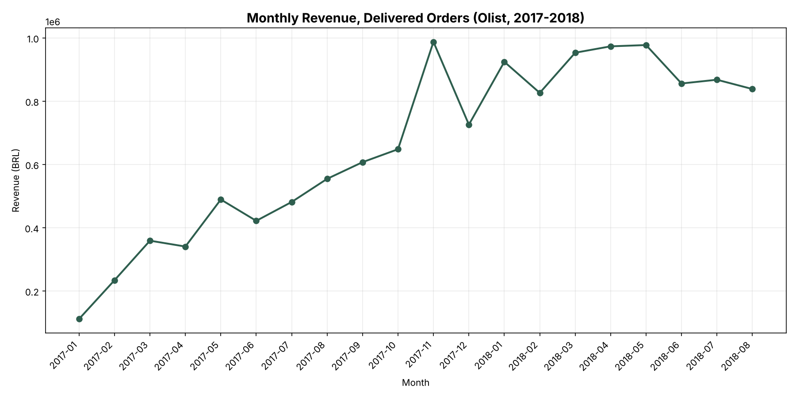
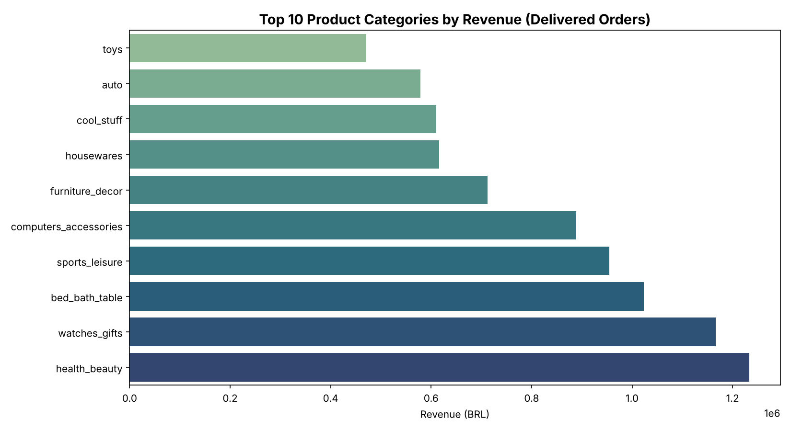
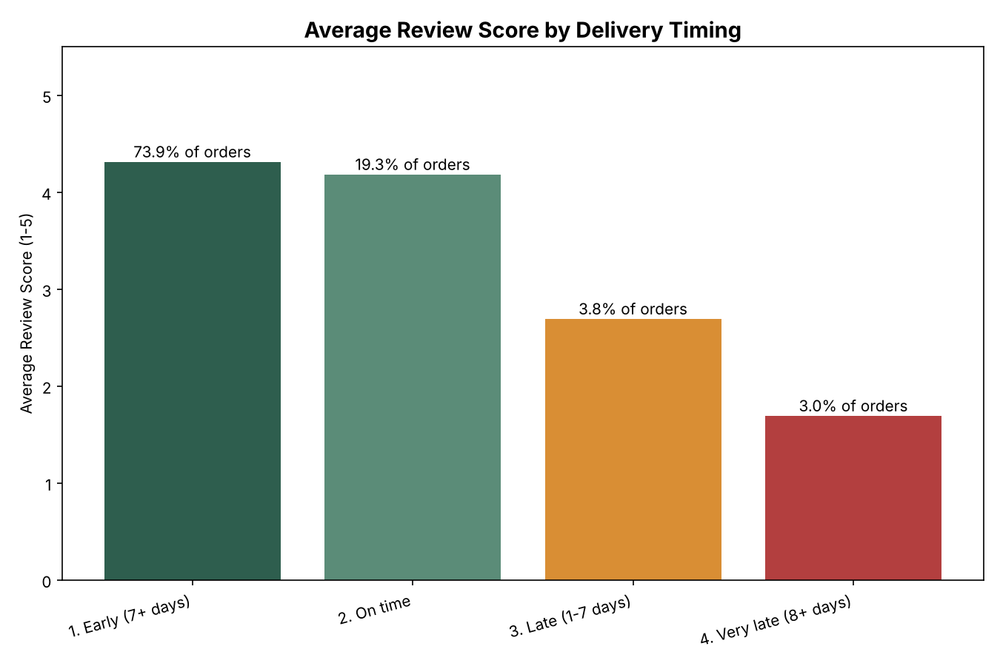

# Olist E-Commerce SQL Analysis

**Data Analysis | SQL (SQLite), Python, Pandas**

A SQL-first analysis of ~100K orders from Olist, a Brazilian e-commerce marketplace, examining what actually drives revenue and what drives customer satisfaction — and whether those turn out to be the same thing.

**Full SQL analysis:** [sql/02_analysis_queries.sql](./sql/02_analysis_queries.sql)
**Notebook (queries run + visualized):** [olist_sql_analysis.ipynb](./olist_sql_analysis.ipynb)
**Schema:** [sql/01_schema.sql](./sql/01_schema.sql)

## Research Question

Which product categories and sellers drive the most revenue on Olist's marketplace, and does late delivery measurably hurt customer review scores? The dataset spans 8 relational tables (orders, customers, order items, products, sellers, payments, and reviews), so answering this requires joining across most of them rather than working from a single flat file.

## Business Questions

Each question below maps directly to one query in [sql/02_analysis_queries.sql](./sql/02_analysis_queries.sql):

1. **How is revenue trending month over month, and where did growth accelerate or stall?** *(Query 1)*
2. **Which product categories generate the most revenue — and do the highest-revenue categories also have the happiest customers?** *(Query 2)*
3. **Does a late delivery measurably hurt the customer's review score, and how much of the order volume is actually affected?** *(Query 3)*
4. **Which sellers generate the most revenue, and does being a top earner also mean delivering a good customer experience?** *(Query 4)*

## Data Source

**Olist Brazilian E-Commerce Public Dataset** — ~100,000 orders placed on the Olist marketplace between 2016 and 2018, covering order status, items, prices, freight, payments, customer and seller location, product category, and post-purchase review scores. Originally published by Olist.

## Approach

1. **Schema + load** — raw CSVs are loaded into a normalized SQLite database (`build_database.py`, schema in `sql/01_schema.sql`) rather than analyzed as flat files, so the analysis queries are real joins across `orders`, `order_items`, `products`, `sellers`, `order_payments`, and `order_reviews`.
2. **SQL analysis** (`sql/02_analysis_queries.sql`) — four queries using CTEs, window functions (`LAG`, `RANK`), and `CASE`-based bucketing:
   - Monthly revenue trend with month-over-month % change
   - Top 10 product categories by revenue and average review score
   - Delivery delay (actual vs. estimated delivery date) bucketed against average review score
   - Top 10 sellers by revenue, ranked, filtered to sellers with enough orders to trust their average score
3. **Visualization** — the notebook runs each query and charts the results.

## Data Quality Note

While building the schema, `review_id` turned out not to be unique — 827 of ~100,000 review rows reuse an existing `review_id` (most plausibly a re-submitted or updated review). It's kept as a plain column rather than a primary key for that reason; see the notebook's data quality section for the verification query.

## Findings

### 1. Monthly revenue trend



Revenue grows steadily from early 2017 through late 2017 as the marketplace scales, then roughly plateaus through 2018. (The dataset has only a handful of orders before 2017, so the chart starts there to avoid a misleading spike.)

### 2. Top 10 categories by revenue



`health_beauty` and `watches_gifts` lead on revenue, ahead of `bed_bath_table`. Average review scores across these top categories sit in a fairly tight 3.9–4.2 range — category alone doesn't explain much variation in customer satisfaction.

### 3. Delivery timing vs. review score



This is the clearest signal in the data. Orders delivered on time or early average **4.2–4.3 stars**. That collapses to roughly **2.7 stars** once an order runs 1–7 days late, and lower still beyond that — even though late orders are a small share (under 7%) of all delivered, reviewed orders. Delivery timing looks like a far stronger lever on customer satisfaction than product category.

## Key Findings

- Revenue scaled steadily through 2017 and plateaued through 2018.
- The highest-revenue categories don't show meaningfully higher or lower customer satisfaction than lower-revenue categories.
- Late delivery is strongly associated with lower review scores (4.2+ stars on time vs. ~2.7 stars when 1–7 days late) — the strongest relationship found in this analysis.
- Revenue rank and review-score quality are distinct axes for sellers too: a top-5 seller by revenue can still underperform on customer experience.

## Tools & Libraries

SQL (SQLite), Python, Pandas, Matplotlib, Seaborn

## Reproducing this analysis

```bash
pip install pandas matplotlib seaborn
python build_database.py   # builds olist.db from data/*.csv
jupyter notebook olist_sql_analysis.ipynb
```
